# Rapidly deploy and configure your Java applications with WebSphere Liberty and OpenShift Container Platform

 

**Last updated:** October 2026

**Status: ** DRAFT - work in progress

**Duration:** 60 minutes

Need support? Contact **Lars Besselmann, Sebastian Porro**

## Overview
This lab provides fundamental hands-on experience with modernizing existing Java applications to WebSphere Liberty, deployed into a container platform, such as Red Hat OpenShift. 

The focus of this lab is on the practical aspects of application deployment and configurations and not the analysis of the Application Modernization Accelerator results. *Other labs cover Application Modernization Accelerator in detail.*

Upon completion of this lab, you will have gained skills to download and use the `Application Modernization Accelerator migration plan` to deploy and configure your application in the following scenarios: 

1.  **to a locally running WebSphere Liberty** - useful for deploying to Liberty in a VM

2.  **to a container image** – useful for deploying to Kubernetes

3.  **using the Liberty Operator** – useful for deploying to OpenShift


**IBM Application Modernization Accelerator** (Application Modernization Accelerator) is an application modernization tool that helps you quickly evaluate on-premises Java EE applications for deployment to the cloud. 

The Application Modernization Accelerator tool provides the following value:

  - Identifies the Java EE programming models in the app

  - Determines the complexity of replatforming these apps by listing a high-level inventory of the content and structure of each app

  - Highlights Java EE programming model and WebSphere API differences between the WebSphere runtime profile types 

  - Identifies Java EE specification implementation differences that might affect the app

  - Generates accelerators for deploying the application to Liberty and containers in a target environment

Additionally, the tool provides a recommendation for the right-fit IBM WebSphere Application Server edition and offers advice, best practices, and potential solutions to assess the ease of moving apps to Liberty or newer versions of WebSphere traditional. It accelerates application migrating to cloud process, minimizes errors and risks and reduces time to market.


## Objective

The objectives of this lab are to:

  - Learn how to download the application migration plan and use it to deploy an application to WebSphere Liberty running locally

  - Learn how to fully populate the migration plan placeholders and build the application into a container image

  - Learn the role of Kustomize when deploying the migration plan

  - Learn how to deploy your application to OpenShift with a single command

  - Learn how to create multiple configurations for the application and deploy them to OpenShift


## Prerequisites

The following prerequisites must be completed prior to beginning this lab:

  - Familiarity with basic Linux commands

  - Have internet access

  - Access to the TechZone lab environment

## Accessing the lab environment

If you are doing this lab as part of an instructor led workshop (virtual or face to face), an environment has already been provisioned for you. The instructor will provide the details for accessing the lab environment.

Otherwise, you will need to reserve an environment for the lab. You can obtain one here. Follow the on-screen instructions for the “**Reserve now**” option.

[https://techzone.ibm.com/collection/liberty-getting-started-labs-demos/environments?platform=6ae1b4145090306a5c3b1a83](https://techzone.ibm.com/collection/liberty-getting-started-labs-demos/environments?platform=6ae1b4145090306a5c3b1a83)

The lab environment contains of a Desktop machine and several other VMs spinning up an OpenShift cluster five Linux VMs and an OpenShift cluster.


## Lab Tasks

In this lab, you will use the Application Modernization Accelerator `migration plan` to build a container image and deploy an application to a local container for testing.

To simplify the lab and to allow you to focus on the migration plan, certain software and artifacts have already been put in place for you. These are as follows:

  - **Application Modernization Accelerator** has been installed and collected data has been loaded

  - **podman** (for creating and running images) has been installed

  - **oc** (OpenShift command Line tool for running OCP commands) has been installed

  - The **PlantsByWebSphere Sample Application**, built as an Enterprise Archive file (EAR) is available from the lab resource provided.

# Part 0: Prepare environment

**Disable docker**

    sudo mv /bin/docker /bin/docker.sav

**Set OCP variables**

    cat /usr/local/share/applications/OpenShiftConsole.desktop | grep http > OCP_URL.txt
    OCP_CONSOLE_URL=$(sed 's/Exec=\/usr\/bin\/xdg-open //g' OCP_URL.txt)
    sudo echo "export OCP_CONSOLE_URL=$OCP_CONSOLE_URL" >> ~/.bashrc
    OCP_BASE_URL="${OCP_CONSOLE_URL:34}"
    sudo echo "export OCP_BASE_URL=$OCP_BASE_URL" >> ~/.bashrc


**Install AMA**

    /tmp/post_deploy_repo/scripts/AMA_510_install_new.sh
    sh ~/software/AMA/AMA_apply_Full_Key.sh 

**Move/remove files to backup**

    mkdir ~/backup
    mv ~/Student ~/backup
    rm -rf ~/binary-scanner
    rm -rf ~/IBM
    rm -rf ~/transformation-advisor-local-3.8.1
    sudo rm -rf /home/techzone

1. Create Student directory

        mkdir -p ~/Student/temp

2. Clone the project repository

       git clone https://github.com/LarsBesselmann/LibertyGettingStarted-2026-OCP-Lab ~/Student/temp
       mv ~/Student/temp/lab_sources/* ~/Student
       rm -rf ~/Student/temp
       ls -lrt ~/Student
    

3. Create podman container with the PlantsByWebSphere database pbwdb

       cd ~/Student

       sudo podman build -t plantsdb-db2 ./plantsdb-db2

       sudo podman run --privileged=true -d \
        --name plantsdb-db2 \
        -p 50000:50000 \
        -e LICENSE=accept \
        -e DB2INST1_PASSWORD=db2password \
        -e DBNAME=PLANTSDB \
        -v plantsdb-data:/database \
        plantsdb-db2

        netstat -an | grep 50000


# Part 1: Application Assesment    

## 1.1 Launch Application Modernization Accelerator (local)

Application Modernization Accelerator provides a **`migration plan`** for each application being assessed for modernization. The migration plan includes a **`migration plan`** of generated artifacts that accelerate the deployment of applications to Liberty in containers and Kubernetes / OpenShift.

The migration plan includes diverse artifacts, depending on the needs of the application to accelerate the build and deployment of an application Container image into an OpenShift container platform.

The Application Modernization Accelerator is installed locally on the **Workstation** VM. 

1. Launch the Application Modernization Accelerator tool using the steps below.

    a.  From **Workstation** VM Desktop Tool Bar, click the `Terminal` icon to open a Terminal window.

    b.  Launch the **Application Modernization Accelerator** with commands:

        cd ~/usr/IBM/application-modernization-accelerator-local-*

        ./launch.sh
        
     Wait for Application Modernization Accelerator to initialize and display the **action menu** list.

    c.  If not already started, type **`5`** and press **`Enter`** to “Start” the **Application Modernization Accelerator**.

     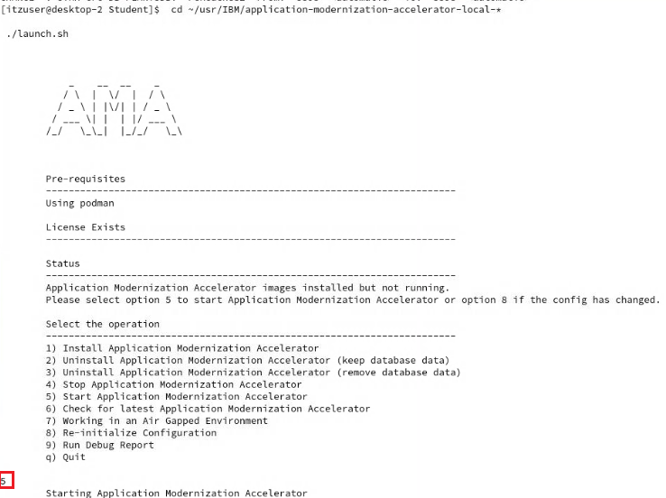
 
    d. The **Application Modernization Accelerator** application is started, **`right-click`** the application URL link and select **`Open Link`** to launch it in a web browser window.
 
     The URL is displayed in the output from the AMA command: **https://desktop-2xxx:3000**
 
     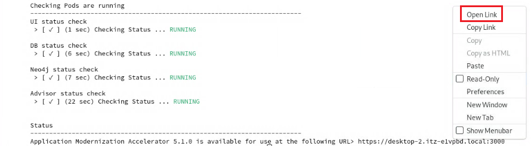
 

    e. Accept the security warning

     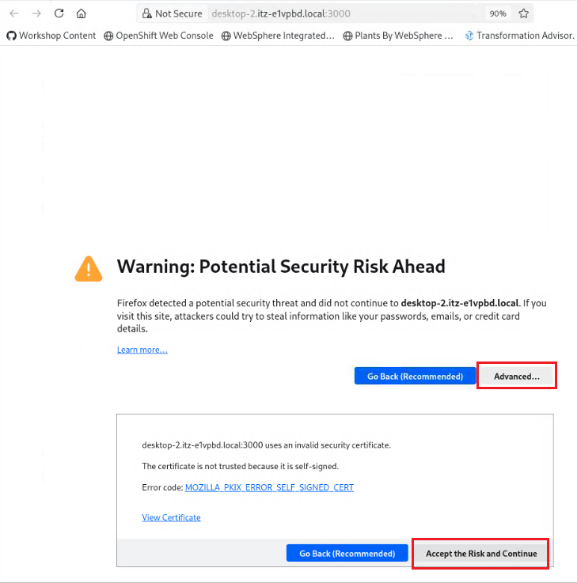
 
 
    f. Accept all cookies

     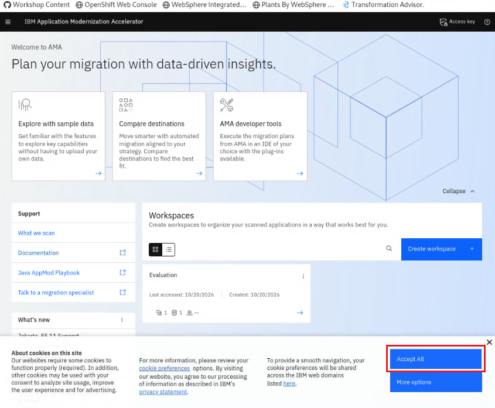
 
    

     The **Application Modernization Accelerator** Home page is displayed in the Web Browser.
 
     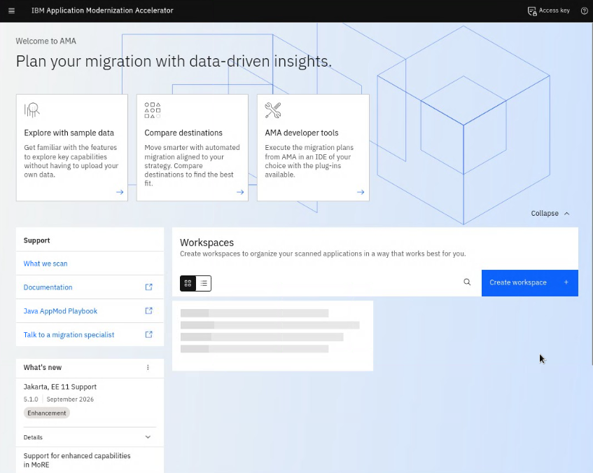

    In the next section, you will create a new “**Workspace**” in Application Modernization Accelerator and upload the saved results from the scan of a WebSphere Application Server that has a single application deployed, named “PlantsByWebSphere”.


## 1.3 Create new workspace and upload scan results from a WebSphere Application Server

In this section, create a new workspace named **'Evaluation'**.

A `workspace` is a designated area that will house the migration recommendations provided by Application Modernization Accelerator based on the Data Collector scan results of your application server environment.

1. Create a new workspace named **Evaluation**

    a.  From the Application Modernization Accelerator Home page, click the **`Create New`** button

    b.  Type **`Evaluation`** as the Workspace name. Then click the **`Create`** button

     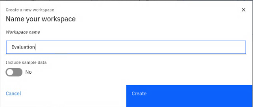

2. Upload an existing **'scan results'** file provided for the lab.

    The scan results file is provided for you.

    It was produced by running the Application Modernization Accelerator **Data Collector** on a WebSphere Application Server that had the **PlantsByWebSphere** application deployed.

    a. Click the **`Upload results`** button

    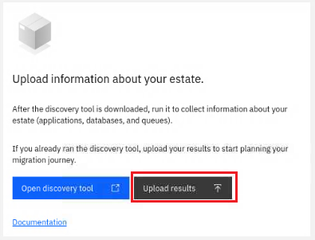


    b. Click the **`Drop or add file`** link. Then click the **`Upload`** button

    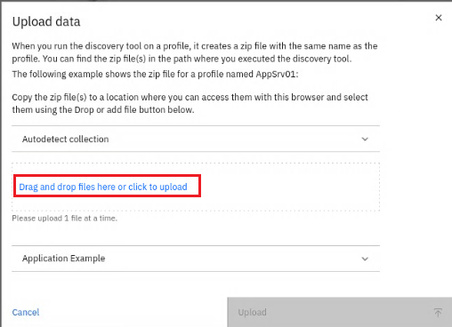


    
    c.  Navigate to **Home \> itzuser \> Student \> ama**

    d.  Select **`Dmgr.zip`** file. Then click the **`Open`** button

    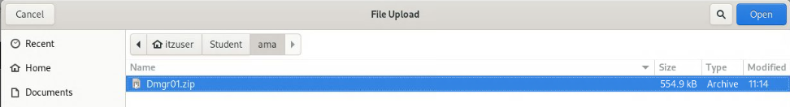

    e. Once the **Dmgr.zip** has been added, click on the **`Upload`** button to upload the results into Application Modernization Accelerator.

    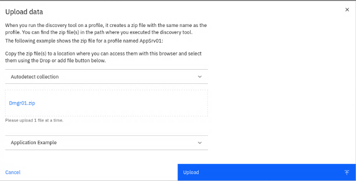

    After a few moments, the application data will be uploaded to the Application Modernization Accelerator UI. You will be asked to select the target runtime. Select **Liberty** and click on **Confirm**.

    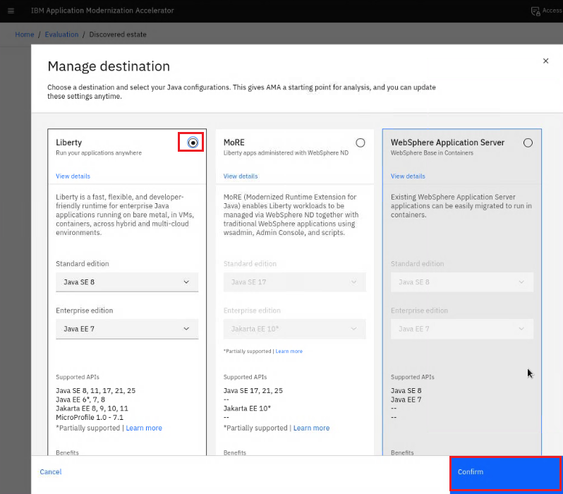

    
    The "**Evaluation**" workspace displays the “Visualization** of all applications in that workspace. The application you will focus on in the lab is the PlantsByWebSphere application which consists of a Java Enterprise application and a database.

    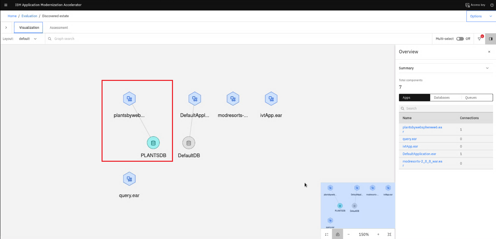

    
    Click on **Assessment** to see more details about the different applications.

    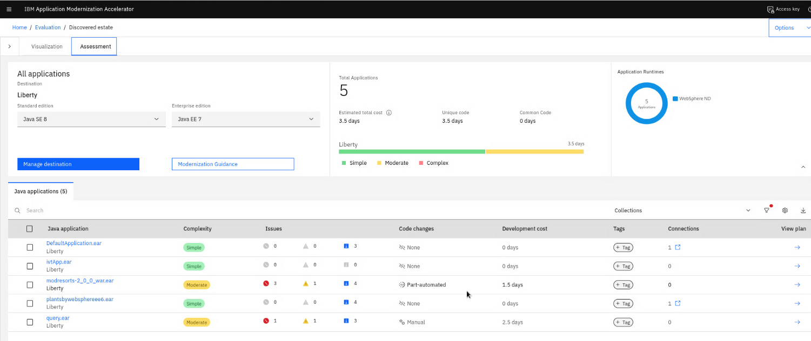


    You can see five applications with their complexity, migration issues, efforts and more. You will focus one the one called **plantsbywebsphereee6.ear**.
    
    


## 1.4 Analyze the plantsbywebsphereee6 application

 Application Modernization Accelerator provides detailed information about each application that has been analyzed. This application **plantsbywebsphereee6.ear** has a complexity of **`Simple`**.
 
 **Simple** means:
 
  - The application is ready to be deployed to WebSphere Liberty
  - No changes to the source code are required
 
   
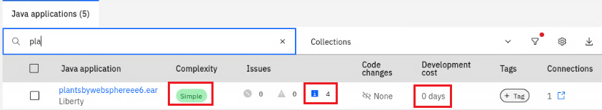

 ***How is this application ready for deployment when it shows 4 issues?***
 
 In this case, the application has four **`Informational`** issues.
 
 Informational issues do not prevent the application from executing on the new runtime (WebSphere Liberty) but there may be small changes in the application’s behavior.
 
 If unexpected behavior is found during testing, then reviewing these **Informational** issues may help explain what is happening.

1.  We are now ready to review the **'migration plan'** for this application. 

    a. Click on the **`Migration plan`** link at the end of the row of the **plantsbywebsphereee6.ear** application.

    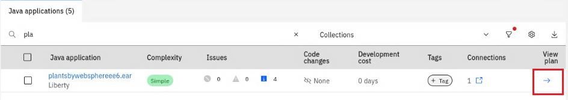

    b.  The **Migration Plan** page opens.

    This page contains a summary of the application being migrated:

    - a preview of the files that will help during deployment (highlighted below)

    - a list of the application’s dependencies.

    All the files can be downloaded in a single convenient **migration plan**.

    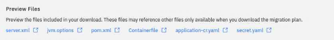

2. At the bottom of the screen, there is an `Application dependencies` section. 
    
    This shows all the files, in addition to the application, that are required for a deployment. **Plantsbywebspheeee6.ear** has four dependencies.

    a. Expand the section it to see the details

    b. In this case, DB2 drivers called **db2jcc.jar** and **db2cc_licence.jar** are required for deployment (you might see additional libraries but those are not required in that case.)

    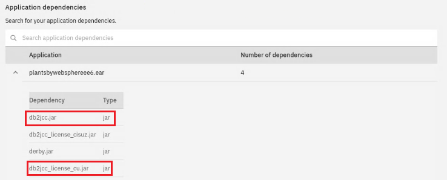

3.  Download the migration plan by clicking the **`Download plan`** button in the bottom right. 

    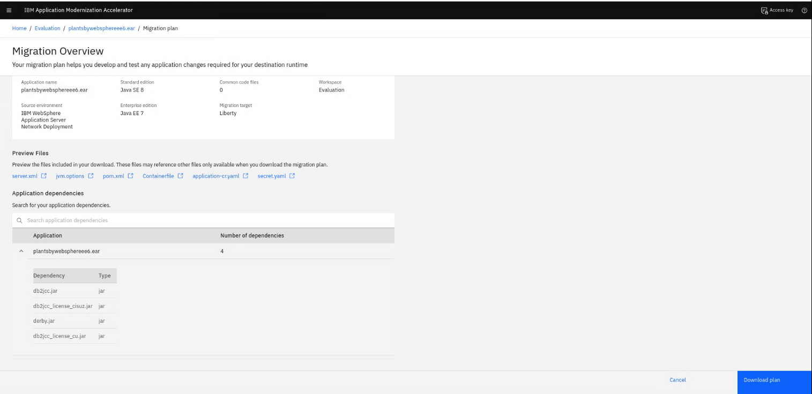

    If you get a security warning, accept the risk and continue.

    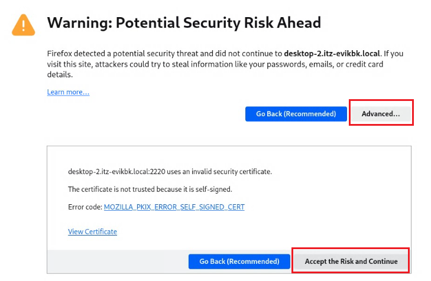
    

    A zip file named “**plantsbywebsphereee6.ear_migrationPlan.zip**” will download to your **Download** folder.


We will go through a step-by-step process of using the Application Modernization Accelerator migration plan to deploy **plantsbywebsphereee6.ear** as follows:

  1. Ensure the application can run locally on WebSphere Liberty

  2. Build an immutable container image running on WebSphere Liberty

  3. Deploy the image to OpenShift (and configure it) using a single command

  4. Redeploy and reconfigure this image for a new environment with a single command

# Part 2: Deploy PlantsByWebSphere app to a locally running WebSphere Liberty    

In this step, you will create a new Liberty server to run the PlantsByWebSphere application.

Then, you will review the migration plan to see what files you need to add, and use the provided `server.xml` Liberty configuration file. This file is used to configure Liberty by providing values for ports, security, context routes and by providing application-specific configuration. 

### 2.1   Create a local Liberty Server

1.  From a **`Terminal`** window, download and install the Liberty archive.

        wget https://public.dhe.ibm.com/ibmdl/export/pub/software/websphere/wasdev/downloads/wlp/26.0.0.6/wlp-webProfile7-26.0.0.6.zip -P ~/Student
        cd ~/Student
        unzip wlp-webProfile7-26.0.0.6.zip


    

2.  From the **`Terminal`** window, create a new local WebSphere Liberty server named ‘**pbwserver**”

        ~/Student/wlp/bin/server create pbwserver

    **output:**

    ```
    Server pbwserver created.
    ```
3.  From the **Terminal** window, start the local WebSphere Liberty server.

        ~/Student/wlp/bin/server start pbwserver

    **Output:**

    ```
    Starting server pbwserver.

    Server pbwserver started with process ID #####
    ```

4.  Confirm the local WebSphere Liberty server is running. Open the `Firefox` web browser, open a new browser tab. Then go to: **http://localhost:9080**

    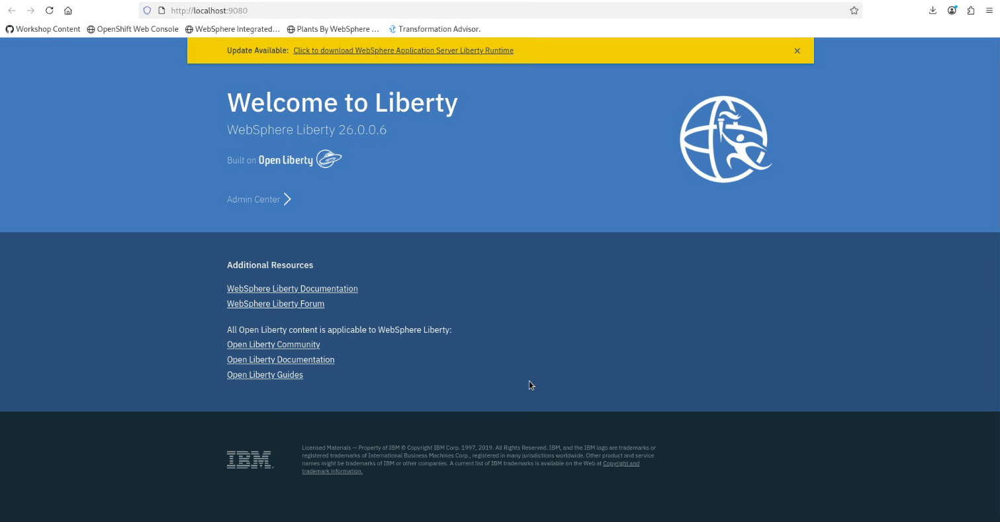


5.  From the **Terminal** window, stop the local WebSphere Liberty server.

        ~/Student/wlp/bin/server stop pbwserver

    **Output:**

    ```
    Stopping server pbwserver.
    Server pbwserver stopped.

    ```


### 2.1.3 Review the placeholder files in the migration plan

In this section, you will review the migration plan to see what files need to be added to the WebSphere Liberty configuration to run the application. 

1.  Let’s make note of the 5 `placeholder files` that are placed in the `migration plan`.

    The placeholder files are convenient references to let you know which files you will need to copy to the **Liberty server**.
 
    *Note: You will fully populate the migration plan in later steps*.

    a.  From the **Terminal window**, list the placeholder files in the migration plan.

        unzip -l ~/Downloads/plantsbywebsphereee6.ear_migrationPlan.zip | grep placeholder
 
    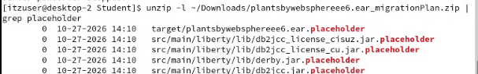
 
    - The **`target`** directory contains the placeholder file for the PlantsByWebSphere application EAR deployment file. This is a reminder that you need to copy the PlantsByWebSphere EAR file the Liberty server.

    - The **`src/main/liberty/lib`** directory contains the placeholder files for the DB2 database libraries required by the application. This is a reminder that you need to copy the DB2 libraries to the Liberty server.

    <br/>

### 2.1.4   Configure the Liberty server for PlantsByWebSphere

In this section, extract the migration plan that you downloaded. Then, copy the required dependency files and server configuration to the Liberty server.

  - Extract the **migration plan** to a new directory

  - Copy the **DB2 libraries** to the directory defined in the "DB2 driver configuration" in the server.xml file.

  - Copy the **PlantsByWebSphere EAR** file to the “apps” directory of the Liberty server

  - Copy the **server.xml** file from the migration plan to the Liberty server, replacing the default server.xml file


1. Extract the migration plan that you downloaded

        mkdir ~/Student/migrationPlan
        cd ~/Student/migrationPlan
        cp ~/Downloads/plantsbywebsphereee6.ear_migrationPlan.zip .
        unzip plantsbywebsphereee6.ear_migrationPlan.zip


2. List the directory of the extracted migration plan

        ls -l        

    The migration plan contains the files to build and deploy the PlantsByWebSphere application to Liberty, in containers, and on OpenShift.     

    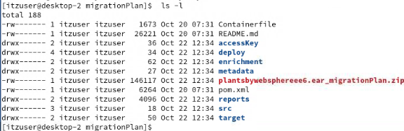
 

3.	Copy the PlantsByWebSphere application binary file into the `apps` location in Liberty

        cp ~/Student/plantsbywebsphereee6.ear ~/Student/wlp/usr/servers/pbwserver/apps

4. Create the `global shared` directory in Liberty. 

    This is where you will copy the DB2 libraries for Liberty

        mkdir -p ~/Student/wlp/usr/shared/config/lib/global
 
5.	Copy the DB2 driver files into the `global shared` location in Liberty.

    This will make it available to any application running in Liberty.

        cp ~/Student/db2_drivers/* ~/Student/wlp/usr/shared/config/lib/global

        ls -lrt ~/Student/wlp/usr/shared/config/lib/global


6.	Copy the `server.xml` file from the migration plan into the Liberty server to replace its existing configuration. Choose to overwrite the existing file if prompted.

        cp ~/Student/migrationPlan/src/main/liberty/config/server.xml ~/Student/wlp/usr/servers/pbwserver 

7.	Configure Liberty to use Java 8 instead of Java 21.

        echo "" >> ~/Student/wlp/usr/servers/pbwserver/server.env

        echo "JAVA_HOME=/usr/lib/jvm/ibm-semeru-open-8-jdk" >> ~/Student/wlp/usr/servers/pbwserver/server.env
 
8. Configure Liberty to use JPA 2.0 instead of JPA 2.1. 

        sed -i 's/jpa-2.1/jpa-2.0/g' /home/itzuser/Student/wlp/usr/servers/pbwserver/server.xml
    

9. Install the missing Liberty features required to run the application

        ~/Student/wlp/bin/featureUtility installServerFeatures pbwserver


    ___

    Now that the PlantsByWebSphere binary and its configuration are added to the Liberty server, the application is ready to be run from the web browser.     
    ___

9. Start the Liberty server

        ~/Student/wlp/bin/server start pbwserver --clean


10.  Run the PlantsByWebSphere application from the browser.

        http://localhost:9080/PlantsByWebSphere
 
        Now the application is running in Liberty, and the main page is displayed.
 
        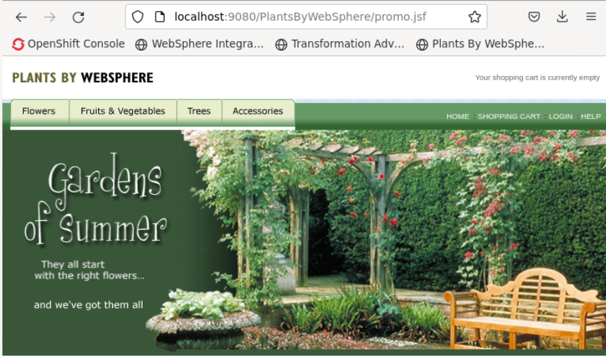

11.  Attempt to click on any of the tabs: “**Flowers**”, **Fruits & Vegetables**”, or “**Trees**”.

12. **Note the exception.** This is an expected error. The issue is in the JPA persistence (Database access). A user is not defined, and therefore authentication to the database failed.
 
    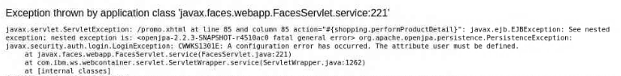
 
    ___

    These pages should display a catalog of items in their respective category, which are retrieved from the application database. 

    **So what happened?** 
    
    Application Modernization Accelerator does not collect any `sensitive data` for the application server.  This means the application-specific configuration information in the **server.xml** file has not been set. In this case, the `username` and `password` to access the database are missing.

    In the next section, you will review the server.xml file and add the sensitive data required to access the application database.  

    <br/>

### 2.1.5   Review the server.xml file

Now you will review the **`server.xml`** file and set the necessary configuration information. 

The **server.xml** file defines a set of **`features`** that the application requires. By importing only the necessary **features** to support the application’s API needs, the footprint of the deployed application and Liberty server is kept as small as possible.

1. Review the server.xml file

    Using the “**`gedit`**” editor in a **`Terminal`** window, open the **server.xml** file located in the Liberty server

        gedit ~/Student/wlp/usr/servers/pbwserver/server.xml &

    - **Section 1** contains the `features` that the application requires, and these are discovered automatically during analysis performed by the Application Modernization Accelerator **Data Collector**.

      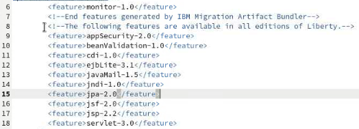

    - **Section 2:** Defines the `resources` required to access the database

      - The **`authdata`** defies the BD2 user and password that is used by the datasources. These refer to variables that are defined in the server.xml file.

      - The **`jdbc`** driver defines the required libraries. These are the libraries you copied into this location via the script

      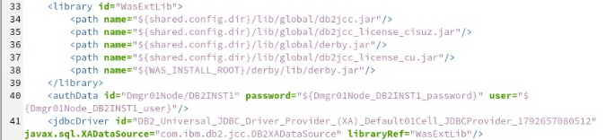

    - **Section 3:** The **`datasource`** contains all the information required to access the database: Database user, password, database name, host, and port number.

      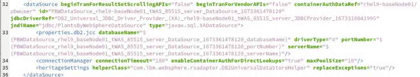


    - **Section 4** contains the variables for the **`non-sensitive configuration data`**. For example, the port to run the server on. The values of these variables are collected by Application Modernization Accelerator.

      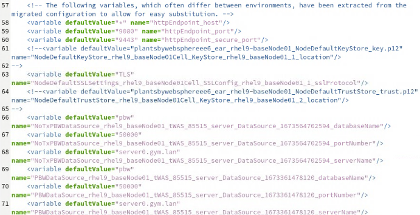

    - **Section 5** contains the **`sensitive data variables`**. 
    
      You can see that the values for these variables are all **blank**, as this information is **never** collected by Application Modernization Accelerator.

      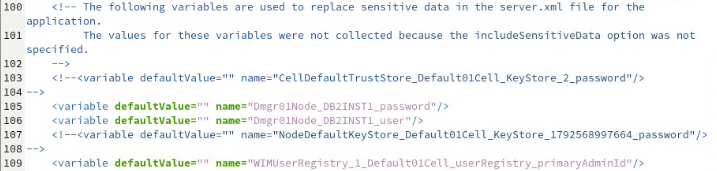


2.  The reason that the **PlantsByWebSphere** application returned an “Exception” is because the values for the **sensitive variables** have not been set - neither in the server.xml nor in the environment. 
  
    

    Next, you will update the server.xml to include the credentials required to access the application database. 


### 2.1.6   Update the server.xml and retest the PlantsByWebSphere application


1. From a Terminal window, `stop` the Liberty server named ‘pbwserver”

        ~/Student/wlp/bin/server stop pbwserver

2. From the `gedit` editor that you have open, update the values in the **server.xml** file for the sensitive data as illustrtated below:

    a. Scroll to the bottom of the `server.xml` file to view the sensitive-data variables. 

    b.  Set the default value for **Dmgr01Node_DB2INST1_password** to: **`db2password`**
    
    c. Set the default value for **Dmgr01Node_DB2INST1_user** to: **`db2inst1`**

     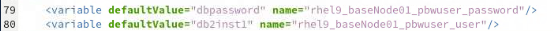
    
    d. **`Save`** and **`close`** the server.xml in the editor

    e. You might have detected that the database host is defined in the server.xml as **vm-1** but now is located on the host **desktop-2**.
    Use the following command to replace it.

        sed -i 's/vm-1/desktop-2/g' /home/itzuser/Student/wlp/usr/servers/pbwserver/server.xml

3. From a Terminal window, `start` the Liberty server named ‘pbwserver”

        ~/Student/wlp/bin/server start pbwserver


4. Reload and test PlantsByWebSphere application in the browser

    http://localhost:9080/PlantsByWebSphere

    If you would now attempt to click on any of the tabs: “Flowers”, Fruits & Vegetables”, or “Trees”, you would see that the error has gone but you would see another error like this as the database has not been initialized yet..

    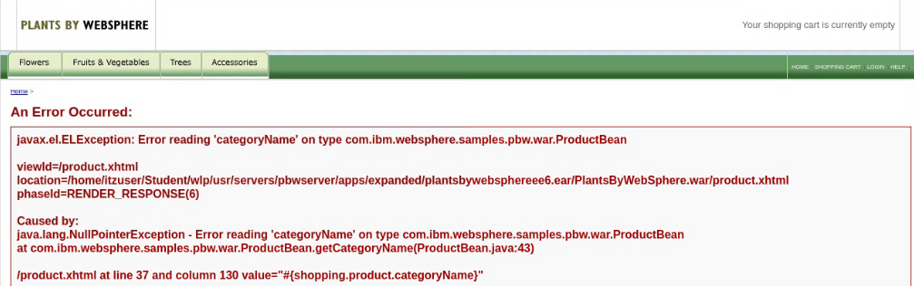
    
    Therefore, before we can fully test the application, we need to initialize the database.

    a. Click on Help to get the help panel

    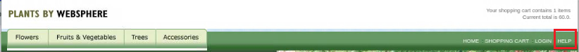
    
    b. Click on the **Reset database** button to reset the database.

    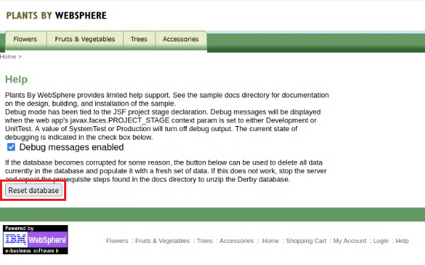

    c. Back on the main page, click the “**Flowers**” tab. The catalog of flowers should now be displayed.

    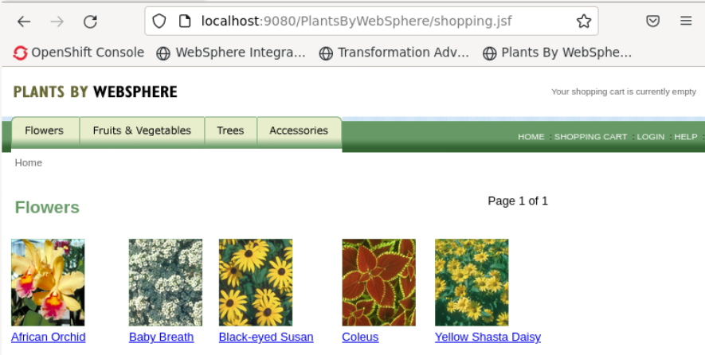


3. From a **Terminal** window, `Stop` the Liberty server named ‘**pbwserver**”

        ~/Student/wlp/bin/server stop pbwserver


### Checkpoint

At this point in the lab, you have successfully demonstrated the PlantsByWebSphere application runs successfully in WebSphere Liberty on a local VM. 

In the next sections, you will deploy the PlantsByWebSphere application to containers and Red Hat OpenShift. 

# Part 3: Create and run the PlantsByWebSphere application as a container image    


## 3.1  Explore the Containerfile used to build PlantsByWebSphere as a container image

In the previous section, you used the **server.xml** to get the  application running on a `local Liberty instance`. This was to show you how the Application Modernization Accelerator **server.xml** file is used. If you are moving to Liberty in VMs as your new runtime, then you are done! 

However if containers are to be your final destination, this section explores the Application Modernization Accelerator migration plan artifacts that accelerate application deployment to Liberty in containers. 

In the case of **`Simple`** applications, it is not necessary to carry out a separate step of deploying to a local Liberty instance at all. Instead, by using the Application Modernization Accelerator migration plan, you can deploy your application to **Liberty running in a container** all in one go. 

This is what we will do now.


1.	Add the PlantsByWebSphere binary file to your migration plan, and remove the placeholder.

        cp ~/Student/plantsbywebsphereee6.ear ~/Student/migrationPlan/target

        rm ~/Student/migrationPlan/target/plantsbywebsphereee6.ear.placeholder


2.	Add the db2 library files to your migration plan, and remove the placeholder.

        cp ~/Student/db2_drivers/* ~/Student/migrationPlan/src/main/liberty/lib  

        rm ~/Student/migrationPlan/src/main/liberty/lib/*.placeholder

3.	Update the server.xml file as before to adjust the database endpoint and JPA spec. 

        sed -i 's/vm-1/desktop-2/g' /home/itzuser/Student/migrationPlan/src/main/liberty/config/server.xml
        sed -i 's/jpa-2.1/jpa-2.0/g' /home/itzuser/Student/migrationPlan/src/main/liberty/config/server.xml


4.  Modify the "**Containerfile**" to specify a specific version of Liberty to deploy: in this case, **icr.io/appcafe/websphere-liberty:26.0.0.6-kernel-java8-openj9-ubi**

        sed -i 's/websphere-liberty:25.0.0.6-kernel-java8-openj9-ubi/websphere-liberty:26.0.0.6-kernel-java8-openj9-ubi/g' /home/itzuser/Student/migrationPlan/Containerfile


5. The `migration plan` is ready to be used to generate an image of your application running on WebSphere Liberty. To do this, we will use the **`Containerfile`** that comes with the migration plan.


    a. Explore the Containerfile in the migration plan

        gedit /home/itzuser/Student/migrationPlan/Containerfile
 
 
    - The **FROM** statements in the **Containerfile** pull in the following two images. 
     
      - **`Open JDK 8`**
      - **Latest `WebSphere Liberty`**

      

      

       
    - The **RUN** commands in the Containerfile create the necessary folder structures and copies the **`binary files`** from the migration plan into the appropriate locations in the image.

      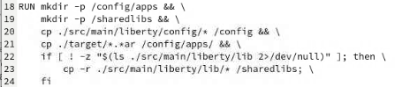

    - There are several lines in the file that have been commented out. 
    
      By default, the **Containerfile** assumes that your application is available as a **binary** file. However, it can also be used to build your application from **source** code. The full details of how to do this can be found in **README.md** in the migration plan.

      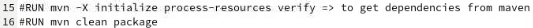

    b. `Close` the "gedit" editor. **DO NOT SAVE ANY CHNAGES TO THE FILE!** 

    <br/>


### 3.2 Setup, build and run PlantsByWebSphere in a local container

In this section, you will build and run the PlantsByWebSphere application in a local container.

1.	Build the container image from the migration plan using podman

        cd ~/Student/migrationPlan

        podman build -f Containerfile --tag apps/pbw .

    - `-f` is the path to the `Containerfile` used to build the image
    - `--tag` allows you to define the name and version of the image to build
    - `.` is the "current directory" of the migration plan that includes the artifacts for building the container image. 

    
2. Confirm the container image has been built

        podman images | grep apps/pbw


    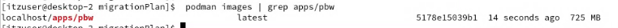


3.	The next step is to run the image using the `podman run`command.

        podman run -d --rm -p 9080:9080 --name pbw-app  apps/pbw

    -  `-d` start the container in 'detached' mode so you get your command prompt back
    -  `--rm` remove the container when it is stopped
    -  `-p` expose the HTTP port
    -  `--name` is the name we are giving the container 


4.	Check that the contaier is up and running. 

        podman ps | grep pbw-app

    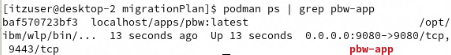


5.  From the browser, access the PlantsByWebSphere application that is running in the local container:

    http://localhost:9080/PlantsByWebSphere
 
     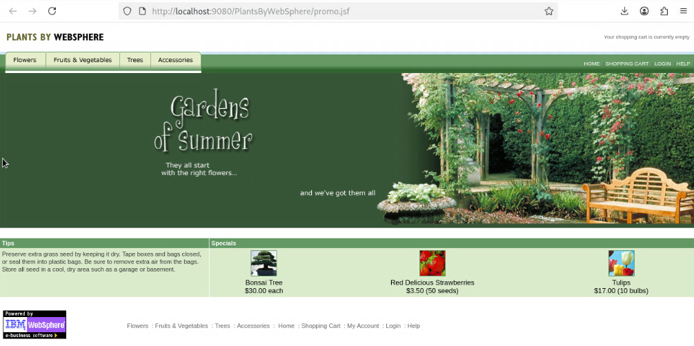
 
    
    Attempt to click on any of the tabs: “**Flowers**”, **Fruits & Vegetables**”, or “**Trees**”.

    ___

    **Note the exception.** This is an expected error. The issue is in the JPA persistence (Database access). A user is not defined, and therefore authentication to the database failed.
 
    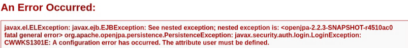
 
    The error is because we are using the unchanged server.xml file that came with the migration plan. 
    
    As outlined already, Application Modernization Accelerator does not collect any sensitive data so the application specific configuration information has not been set. 

6. To make sure the container as is works, let's inject the credentials via environment variables. Restart the container but with slightly different parameters. (This approach is not recommended for production accounts)

        podman stop pbw-app

        podman run -d --rm -p 9080:9080 -e Dmgr01Node_DB2INST1_password="db2password" -e Dmgr01Node_DB2INST1_user="db2inst1" --name pbw-app  apps/pbw 

7.  From the browser, access the PlantsByWebSphere application that is running in the local container:

    http://localhost:9080/PlantsByWebSphere
 
     
 
    
    Attempt to click on any of the tabs: “**Flowers**”, **Fruits & Vegetables**”, or “**Trees**”.

    This time it should work without any issue.

8. Finally stop the container

        podman stop pbw-app


    ___

**Considerations & recommendations:**

Another option here instead of setting environment variables is to update the **server.xml** file, add in the sensitive data values that Application Modernization Accelerator did not collect and rebuild the image. 
    
However, a big part of container image value is that they are **`immutable`**. No matter where you take and deploy the image the operating system, runtime, security patch level, etc. will be the same. 
    
This gives you great **reproducibility** and gets away from the classic ‘**but it works for me!**’ issue. We lose much of this value if we bake in the configuration with the image, as we will have to produce an image for each new configuration. 
    
Instead of using the exact same image in each of your development, staging and production environments, you would be using different images. 

___
   
**It is never best practice to hard code configuration into your image.** 


In the next section we will look at how the `migration plan` helps you manage this configuration easily across all your environments and how it will simplify deployment to your OpenShift cluster. The migration plan uses `Kustomize` to help achieve this.

___


## 3.2 Understand how Kustomize is used in the migration plan

**`kustomize`** is simple way to manage configuration across all your different deployments and environments without the need for templates.

By using **`overlays`**, it allows you to break out your basic configuration information (ports, names, hosts, etc.) from your sensitive data (usernames, password, etc.) that are likely to change in every deployment.

Every **kustomize** artifact is plain `YAML` and can be validated and processed in a standardized way. Plus, it makes them very human readable\! It is natively built into **kubectl** and the **OpenShift client**.

Take a look at the kustomize folder structure in the migration plan:

    tree ~/Student/migrationPlan/deploy/kustomize/

  > 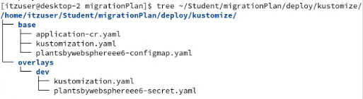
 

The structure of the kustomize folder is as follows.

  1.	`base` contains your expected standard deployment in a `config map` (because it is not sensitive data). It also contains the `application.cr-yaml` file that will execute the deployment and mount the necessary secrets that are created from the secret file.

  2.	`overlays` contains all your different deployment configurations. In this case, only a single deployment has been created for your `dev` systems. The `secret` file will contain all your application-specific **sensitive data** that will be created as secrets in OpenShift.

___

**Note:** In the next section we will use this kustomize structure to deploy your application image. 

Further information on **kustomize** can be found at <http://kustomize.io>
    
___


## 4 Deploy to OpenShift with config

You have now created a container image without any application specific configuration. In this section, we will **push** that image to an image repository and then **deploy** it into OpenShift, along with its configuration, with a single command.

### 4.1 Update the Kustomize structure to move the configmap configuration to the overlays folder

It is common to have different application configuration between deployments such as `dev` and `staging`. In this lab, we use only use one different DB2 application databases between the two configurations. For this reason , we want the configMap to be located in the Kustomize `overlays` folder, rather than the `base` where it is placed, by default, in the Application Modernization Accelerator migration plan. 

For the lab, we have provided the updated file structure for you. You just need to run the commands below to update the migration plan. 

1. Move the configMap to the Kustomize `overlays` folder

       cd ~/Student/migrationPlan/deploy/kustomize
       mv base/plantsbywebsphereee6-configmap.yaml overlays/dev/plantsbywebsphereee6-configmap.yaml

2. Remove the reference to plantsbywebsphereee6-configmap.yaml from base/kustomization.yaml

    a. Edit the file and remove the reference

       cd ~/Student/migrationPlan/deploy/kustomize
       gedit base/kustomization.yaml

    > 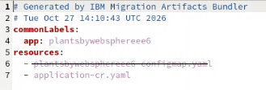

    b. Use the following command to review the final file:

        cat base/kustomization.yaml

    c. The content of the file should now look like this:

        # Generated by IBM Migration Artifacts Bundler
        # Thu Oct 22 17:56:54 UTC 2026
        commonLabels:
          app: plantsbywebsphereee6
        resources:
          - application-cr.yaml

3. Add the reference to plantsbywebsphereee6-configmap.yaml to overlays/dev/kustomization.yaml

    a. Edit the file:

        gedit overlays/dev/kustomization.yaml

    b. Add under ressources the following line:

       - plantsbywebsphereee6-configmap.yaml

    
    c. Use the following command to review the final file:

        cat overlays/dev/kustomization.yaml

    d. The content of the file should now look like this:

        # Generated by IBM Migration Artifacts Bundler
        # Thu Oct 22 17:56:54 UTC 2026
        resources:
          - plantsbywebsphereee6-secret.yaml
          - plantsbywebsphereee6-configmap.yaml
        bases:
          - ../../base


### 4.2 Update the YAML files to add the application configuraton for deployment

Recall, the container image does not have the application configuration baked in. 

You will make the following updates to the configuration YAML files in the migration plan for the PlantsByWebSphere application deployment to OpenShift. 

  -  Update the `base/application-cr.yaml` file
     - Add the reference to the container image
     - Accept the Liberty license
  
  -  Update the `overays/dev/plantsbywebsphereee6-secret.yaml` file
     -  Add the sensitive-data to the **secret** YAML file
  
  - Update the `overlays/dev/plantsbywebsphereee6-configmap.yaml` file
     -  Add the database host imformation to access the dev database


1.  Update the `application-cr.yaml` file
    
    The `application-cr.yaml` is the WebSphere Liberty custom resource used to deploy the PlantsByWebSphere application.
  

    a. Adjust the value of applicationImage from `IMAGE_REFERENCE` to something like
    `default-route-openshift-image-registry.apps.itz-e1vpbd.infra01-lb.dal14.techzone.ibm.com/apps-pbw/pbw-app:1.0`

        imageReference="default-route-openshift-image-registry.${OCP_BASE_URL}/apps-pbw\/pbw-app:1.0"
        echo $imageReference

        sed -i "s|IMAGE_REFERENCE|${imageReference}|g" base/application-cr.yaml


        #sed -i 's/applicationImage: IMAGE_REFERENCE/applicationImage: default-route-openshift-image-registry.apps.itz-e1vpbd.infra01-lb.dal14.techzone.ibm.com\/apps-pbw\/pbw-app:1.0/g' base/application-cr.yaml

    b. Accept the license by replacing `accept: false` with `accept: true`

        sed -i 's/accept: false/accept: true/g' base/application-cr.yaml

    c. Review the updated **application-cr.yaml**
        
        cat ~/Student/migrationPlan/deploy/kustomize/base/application-cr.yaml

    The output should look like this:

    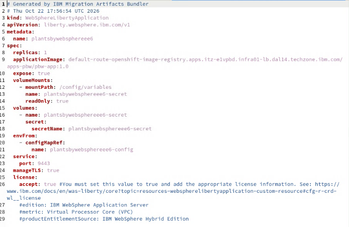

    If you run into any trouble, you can copy the content from below.

        # Generated by IBM Migration Artifacts Bundler
        # Thu Oct 22 17:56:54 UTC 2026
        kind: WebSphereLibertyApplication
        apiVersion: liberty.websphere.ibm.com/v1
        metadata:
            name: plantsbywebsphereee6
        spec:
            replicas: 1
            applicationImage: default-route-openshift-image-registry.apps.itz-e1vpbd.infra01-lb.dal14.techzone.ibm.com/apps-pbw/pbw-app:1.0
            expose: true
            volumeMounts:
            - mountPath: /config/variables
                name: plantsbywebsphereee6-secret
                readOnly: true
            volumes:
                - name: plantsbywebsphereee6-secret
                secret:
                    secretName: plantsbywebsphereee6-secret
            envFrom:
                - configMapRef:
                    name: plantsbywebsphereee6-config
            service:
                port: 9443
            manageTLS: true
            license:
                accept: true


    The updated `application-cr.yaml` in the **base** directory is now complete. The PlantsByWebSphere application configuration is finalized.  

    ___


2.	Update the **plantsbywebsphereee6-secret.yaml** file, which contains the sensitive-data for the application. 

    Adjust the line for the db2 user

    - from: `Dmgr01Node_DB2INST1_user: <REPLACE_WITH_BASE64_ENCODED_DATA>`
    - to: `Dmgr01Node_DB2INST1_user: ZGIyaW5zdDE=`

    Use the following command to do so:

        sed -i 's/Dmgr01Node_DB2INST1_user: <REPLACE_WITH_BASE64_ENCODED_DATA>/Dmgr01Node_DB2INST1_user: ZGIyaW5zdDE=/g' overlays/dev/plantsbywebsphereee6-secret.yaml

    Adjust the line for the db2 password

    - from: `Dmgr01Node_DB2INST1_password: <REPLACE_WITH_BASE64_ENCODED_DATA>`
    - to: `Dmgr01Node_DB2INST1_password: ZGIycGFzc3dvcmQ=`

    Use the following command to do so:

        sed -i 's/Dmgr01Node_DB2INST1_password: <REPLACE_WITH_BASE64_ENCODED_DATA>/Dmgr01Node_DB2INST1_password: ZGIycGFzc3dvcmQ=/g' overlays/dev/plantsbywebsphereee6-secret.yaml

    Adjust the line for the primary admin

    - from: `WIMUserRegistry_1_Default01Cell_userRegistry_primaryAdminId: <REPLACE_WITH_BASE64_ENCODED_DATA>`
    - to: `WIMUserRegistry_1_Default01Cell_userRegistry_primaryAdminId: d2FzYWRtaW4=`

    Use the following command to do so:

        sed -i 's/WIMUserRegistry_1_Default01Cell_userRegistry_primaryAdminId: <REPLACE_WITH_BASE64_ENCODED_DATA>/WIMUserRegistry_1_Default01Cell_userRegistry_primaryAdminId: d2FzYWRtaW4=/g' overlays/dev/plantsbywebsphereee6-secret.yaml

    Review the final file:

        cat overlays/dev/plantsbywebsphereee6-secret.yaml

    The output should look like this:

    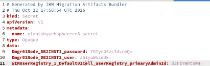

    If you run into any trouble, you can copy the content from below.

        # Generated by IBM Migration Artifacts Bundler
        # Thu Oct 22 17:56:54 UTC 2026
        kind: Secret
        apiVersion: v1
        metadata:
            name: plantsbywebsphereee6-secret
        type: Opaque
        data:
            Dmgr01Node_DB2INST1_password: ZGIycGFzc3dvcmQ=
            Dmgr01Node_DB2INST1_user: ZGIyaW5zdDE=
            WIMUserRegistry_1_Default01Cell_userRegistry_primaryAdminId: d2FzYWRtaW4=
  
      The update to the `plantsbywebsphereee6-secret.yaml` in the **overlays/dev** directory is now complete. The sensitive data is encoded and added to the yaml file. 


    a. `How did we encode the values?` 
    
    We updated the values in the YAML file with the sensitive data by  **Base64 encoding** the values as illustrated below.
 
    - We encoded the following values:
   
      ___

      - user: **db2inst1**

        echo db2inst1 | base64

      The encoded value is: **ZGIyaW5zdDE=**

      ___

      - password: **db2password**

        echo -n "db2password" | base64

      The encoded value is: **ZGIycGFzc3dvcmQ=**

      ___ 

      - user: **wasadmin**

        echo -n "wasadmin" | base64

      The encoded value is: **d2FzYWRtaW4=**


3.	Update the **plantsbywebsphereee6-configmap.yaml** file, which contains the database name and host for the `dev` database

    Adjust the database endpoint from vm-1 to desktop-2

    Use the following command to do so:

        cd ~/Student/migrationPlan/deploy/kustomize
        sed -i 's/vm-1/desktop-2/g' overlays/dev/plantsbywebsphereee6-configmap.yaml

    Review the final file:

        cat overlays/dev/plantsbywebsphereee6-configmap.yaml

    The output should look like this:

    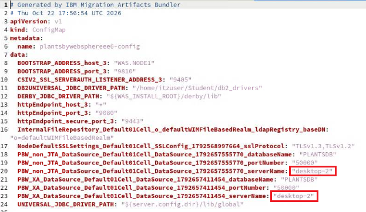

    
    The update to the `plantsbywebsphereee6-configmap.yaml` in the **overlays/dev** directory is now complete. The database host for the dev database has been added to the yaml file. 

Review the final configuration:

        cat overlays/dev/plantsbywebsphereee6-configmap.yaml

The output should look like this:

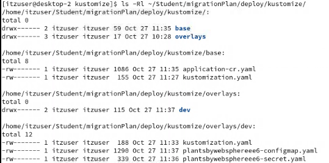

 ### 4.3 Deploy the application and its configuration to OpenShift

To deploy the PlantsByWebSphere application to OpenShift, you must perform the following basic steps.

  - Tag the container image, appropriately tagging for the OpenShift internal registry
 
  - Push the tagged container image to the OpenShift internal registry   

  - Use a single command to deploy and configure the application to openShift


1. Login to OpenShift using your IBM ID 

        oc login -w

2. Create a new project where you will dpeloy the application 

        oc new-project apps-pbw


3. Login to the OpnShift internal registry so you can push the image 

        oc registry login

    The command will return the registry public hostname which should be 
    default-route-openshift-image-registry.apps.itz-e1vpbd.infra01-lb.dal14.techzone.ibm.com

4. Tag the container image using the following podman command

        imageReference="default-route-openshift-image-registry.${OCP_BASE_URL}/apps-pbw\/pbw-app:1.0"
        echo $imageReference

        podman tag apps/pbw ${imageReference}

        #podman tag apps/pbw default-route-openshift-image-registry.apps.itz-e1vpbd.infra01-lb.dal14.techzone.ibm.com/apps-pbw/pbw-app:1.0

5. Verify the image was tagged

        podman images | grep pbw-app

    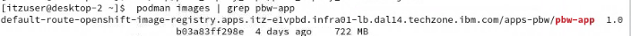


6. Push the container image to OpenShift internal registry 

       imageReference="default-route-openshift-image-registry.${OCP_BASE_URL}/apps-pbw\/pbw-app:1.0"
        echo $imageReference

       podman push ${imageReference}

       #podman push default-route-openshift-image-registry.apps.itz-e1vpbd.infra01-lb.dal14.techzone.ibm.com/apps-pbw/pbw-app:1.0         


In previous steps, you configured the sensitive data that is needed, accepted the license, pointed to the image that is needed to pull,  and logged into OpenShift. Now, with a single command, you can deploy to OpenShift and configure the image. 

You must specify which overlay will provide the configuration (dev in this case).

7. Deploy the PlantsByWebSphere application to OpenShift    

        cd ~/Student/labs/appmod/migration-plan/deploy/kustomize

        oc apply -n apps-pbw -k overlays/dev

    The output should show:
    
    configmap/plantsbywebsphereee6-config created
    secret/plantsbywebsphereee6-secret created
    webspherelibertyapplication.liberty.websphere.ibm.com/plantsbywebsphereee6 created


    Ignore warnings like
    - #Warning: 'bases' is deprecated. Please use 'resources' instead. Run 'kustomize edit fix' to update your Kustomization automatically.
    - #Warning: 'commonLabels' is deprecated. Please use 'labels' instead. Run 'kustomize edit fix' to update your Kustomization automatically.


8. Verify the deployment

        oc get deployment -n apps-pbw

    Wait for the `deployment` to be ready and availabe, as illustrated below:

        NAME                   READY   UP-TO-DATE   AVAILABLE  
        plantsbywebsphereee6   1/1     1            1    


9. Verify the appliation `pod` is ready.

    This may take a few moments. Just keep checking with command below

        oc get pods -n apps-pbw

    Wait for the `pod` to be ready and availabe, as illustrated below:

        NAME                                    READY   STATUS       
        plantsbywebsphereee6-7476449666-shnx8   1/1     Running   

10. From the browser, navigate to the PlantsByWebSphere route for the `dev` deployment:

      https://plantsbywebsphereee6-apps-pbw.apps.itz-e1vpbd.infra01-lb.dal14.techzone.ibm.com/PlantsByWebSphere
 
    The PlantsByWebSphere main page is displayed.

    

11. Click on the **`Trees`** category and view the trees that are loaded in the ‘dev’ database.

    This catalog of trees was retrieved from the DB2 database in the `dev` configuration.
 
    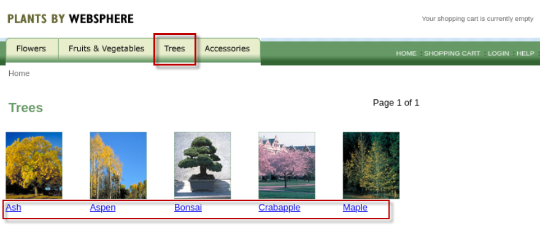


##  4.4 Explore the WebSphere Liberty Operator in OpenShift

In this section, you will take a look at the **WebSphere Liberty Operator** in the OpenShift console to see what has been deployed.

1.  Login to OpenShift console

    a.  Open a new tab in the web browser

    b.  Click on the **`OpenShift Console`** bookmark on the bookmark toolbar

    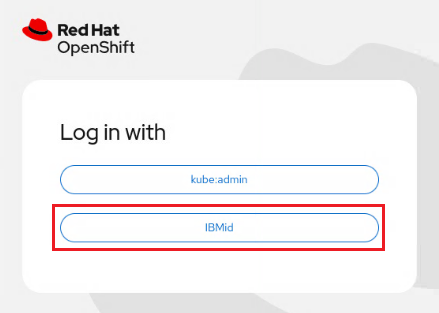
    
    c.  Log in using your **IBMid**

    d. After successful login, you should land on the overview page

    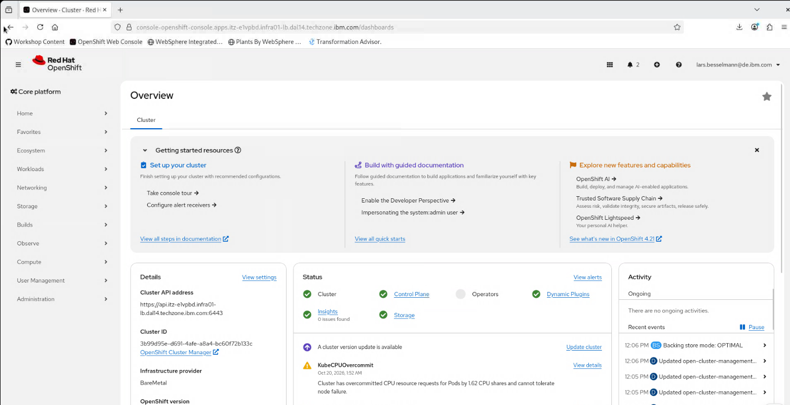
    


2.  View the **IBM WebSphere Liberty** `Operator`

    a.  Click on **`Ecosysytem > Installed Operators`** in the left-hand menu

    

    b.  Click on **`IBM WebSphere Liberty`**

    


3. View the **WebSphereLibertyApplication** `Deployment`

    a.  Click on the tab called **`WebSphereLibertyApplication`**

    


    b. You will see the **plantsbywebsphereee6** application listed in the ‘dev’ namespace

    

    
    b. Click on the link called **`plantsbywebsphereee6`** under the **Name** column

    

    c.  Select the **`Resources`** tab

    

    d. Select the link for the **`Deployment`**

    


    e. The PlantsByWebSphere deployment has one `pod` running

    


4.  View the WebSphereLibertyApplication **`Route`**

    a.  Return to the **plantsbywebsphereee6 operator** page

    


    b.  Click the **`Resources`** tab

    


    c.  Select the link of **Kind: `route`**

    


    d.  Click on the **`Location`** link for the route

       https://plantsbywebsphereee6-apps-pbw.apps.itz-e1vpbd.infra01-lb.dal14.techzone.ibm.com/ 

    


    e.  The **Welcome to Liberty** page is displayed in a new Browser tab. 

    

    f.  Append the context root ‘**PlantsByWebSphere’** to access the PlantsByWebSphere application

      https://plantsbywebsphereee6-apps-pbw.apps.itz-e1vpbd.infra01-lb.dal14.techzone.ibm.com/PlantsByWebSphere


## 4.5 Re-deploy app with different configuration to OpenShift  - To be done

We have deployed the PlantsByWebSphere application with its configuration to `dev`, using a single kustomize command. 

In this section, we will explain how to deploy the same application again with a new configuration for `staging`, again using a single kustomize command. But as there is no second database deployed, this is a read-only task.


1.	Create a new `overlay` directory called **staging** that will store the new staging configuration, coping the existing dev directory.

        cd ~/Student/labs/appmod/migration-plan/deploy/kustomize/overlays

        cp -r dev staging

2.	Update the **plantsbywebsphereee6-configmap.yaml** file, which contains the database name and host for the **staging** configuration.

    As there is no staging database deployed, there is nothing to change here.
 
3. From the `kustomize` directory, apply the new `staging` overlay

        cd ~/Student/labs/appmod/migration-plan/deploy/kustomize

        oc apply -n apps-pbw -k overlays/staging

    **Note:** that the configmap and secret were `configured`,  but the application is `unchanged`, as illustrated below.  

4. Ensure the pod has restarted

        oc get pods -n apps-pbw


5. From the browser, navigate to the PlantsByWebSphere route for the application

 
 
# Summary

___
**Congratulations!**

**You have successfully completed the core learning objectives in the lab**

___

In this lab, you learned how to deploy applications to WebSphere Liberty using the WebSphere Liberty Operator and the deployment artifacts produced by Application Modernization Accelerator in its migration plan.

You explored the options for deployment: 

  - locally running Liberty
  - Liberty as an image running in local container
  - Liberty as an image running in OpenShift.

You learned how to easily configure deployments to OpenShift to allow the same immutable image to be deployed for different configurations such as ‘dev’ and ‘staging’ environment deployments.

You learned about some of the practical ways you can secure your configuration data.

You explored the PlantsByWebSphere assessment details and reports in Application Modernization Accelerator.


___

You may continue your learning journey with the optional sections of the lab. 

___

# Troubleshooting:

## OpenShift related issues

1. oc login fails

If `oc login -w` fails with an error like

    error: dial tcp: lookup xxx no such host - verify you have provided the correct host and port and that the server is currently running.

this indicates that the OCP endpoint has not been set in the configuration. Try the following command to fix it:

    echo $OCP_CONSOLE_URL

If the command returns no URL, you need to set the URL via these commands:

    cat /usr/local/share/applications/OpenShiftConsole.desktop | grep http > OCP_URL.txt
    OCP_CONSOLE_URL=$(sed 's/Exec=\/usr\/bin\/xdg-open //g' OCP_URL.txt)
    sudo echo "export OCP_CONSOLE_URL=$OCP_CONSOLE_URL" >> ~/.bashrc
    OCP_BASE_URL="${OCP_CONSOLE_URL:34}"
    sudo echo "export OCP_BASE_URL=$OCP_BASE_URL" >> ~/.bashrc

Now you can log in via the command:

    oc login -w --server=$OCP_CONSOLE_URL:6443
    

